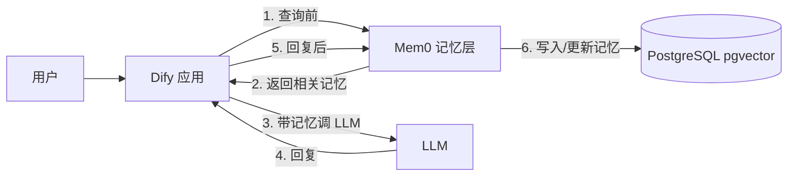

用 **Mem0 + PostgreSQL（pgvector） + Dify** 搭短期/长期记忆的思路，可以概括成一句：
- **短期记忆**：用 Dify 自己的「会话变量 / context window」就能搞定，不需要额外数据库。  
- **长期记忆**：让 Mem0 用 pgvector 做向量存储，Dify 每轮对话前后分别调 Mem0 的 `search` 和 `add`，把事实/偏好写进 PostgreSQL，以后跨会话按语义搜出来用。
下面我按「架构 → 具体接法 → 短期/长期怎么分」讲。
---
## 1. 整体架构：三者怎么分工？
用一个简单数据流图先看全局：

核心分工：
- **Dify**：编排对话、管理会话变量、调 LLM、串联工具节点。
- **Mem0**：记忆引擎，负责：
  - 从对话中自动抽取事实/偏好（`add`）
  - 按语义检索相关记忆（`search`）
  - 冲突检测 & 自动 ADD / UPDATE / DELETE / NOOP
- **PostgreSQL + pgvector**：给 Mem0 当向量 + 元数据存储后端，存 embedding + 事实文本 + 用户 ID / 时间等字段。
---
## 2. Mem0 如何接 PostgreSQL（pgvector）？
### 2.1 确保 pgvector 已就绪
1. 用你现有的 `pgvector/pgvector:pg18` 容器，保证库里有 `vector` 扩展：
```sql
CREATE EXTENSION IF NOT EXISTS vector;
```
2. 建一个专用库（比如 `mem0`），或者直接用现有库也行，只要连接串对。
### 2.2 Mem0 配置 pgvector 提供者
Mem0 官方文档给了一个 pgvector 配置示例：
```python
import os
from mem0 import Memory
os.environ["OPENAI_API_KEY"] = "sk-xx"   # 或你的其他嵌入模型 key
config = {
    "vector_store": {
        "provider": "pgvector",
        "config": {
            # 以下几行按你的 pgvector 容器改
            "user": "postgres",
            "password": "your_password",
            "host": "pgvector",       # 容器名 / 服务名
            "port": "5432",
            "dbname": "mem0",         # 事先建好这个库
            "collection_name": "mem0_memories",  # 表名前缀
            "embedding_model_dims": 1536,        # 与你的嵌入模型一致
        }
    }
}
m = Memory.from_config(config)
```
然后就可以：
```python
# 添加记忆
messages = [
    {"role": "user", "content": "我最近在学 Rust，偏好后端开发"},
    {"role": "assistant", "content": "已记录你的技术栈偏好"},
]
m.add(messages, user_id="user_123", metadata={"category": "tech_pref"})
# 搜索记忆
results = m.search("这个用户的技术背景是什么？", user_id="user_123")
```
Mem0 会在 PostgreSQL 里自动建表，把文本变成向量存起来，并用 pgvector 做相似度检索。
> 小提示：  
> - `embedding_model_dims` 必须和你用的嵌入模型维度完全一致，否则会报错。  
> - 如果用 OpenAI 兼容的国内嵌入模型，就配 `embedder` + `llm` 两个部分，把 `api_key` / `openai_base_url` 换成你的。
---
## 3. Dify 怎么接 Mem0？
有两种常见方式：
### 方式 A：用 Dify 的 Mem0 插件（推荐）
社区已经有 `dify-plugin-mem0` 这类插件，安装后可以在工作流里直接拖「Mem0 添加记忆」「Mem0 搜索记忆」节点。典型流程：
1. 在 Dify 插件市场安装 `mem0` 插件（或上传 `.difypkg`）。
2. 在插件配置里填你的 Mem0 API 地址 / API Key。
3. 在聊天工作流里加三个关键节点：
   - **Pre-LLM：Mem0 Search**  
     - 输入：`query = sys.query`，`user_id = sys.user_id`
     - 输出：`mem0_results`（JSON 记忆列表）
   - **LLM 节点**  
     - System Prompt 里注入 `mem0_results`，类似：
       ```text
       你是一个智能助手。以下是该用户的历史记忆，请务必参考：
       {{mem0_results}}
       ```
   - **Post-LLM：Mem0 Add**  
     - 输入：本轮 `messages`（用户 + 助手），`user_id`
     - 把本轮对话写回 Mem0，长期记忆就更新了。
### 方式 B：自己写 HTTP 请求节点
如果暂时没插件，也可以用 Dify 的「HTTP 请求」工具直接调 Mem0 REST API（v1/v2 都有文档）：
- 写入记忆：  
  - `POST http://mem0-host:8080/v1/memories/`（或你的端口）  
  - Body 示例：
    ```json
    {
      "messages": [
        {"role": "user", "content": "我最近在学 Rust"},
        {"role": "assistant", "content": "好的，我记住你偏后端开发"}
      ],
      "user_id": "user_123"
    }
    ```
- 搜索记忆：  
  - `POST http://mem0-host:8080/v1/memories/search/`  
  - Body：
    ```json
    {
      "query": "这个用户的技术背景是什么？",
      "user_id": "user_123",
      "top_k": 5
    }
    ```
在 Dify 里就是：
1. 一个「HTTP 请求」节点 → 调 `/memories/search/`，把结果放到 `mem0_context` 变量。
2. LLM 节点的 System Prompt 引用 `mem0_context`。
3. 回复后再接一个「HTTP 请求」节点 → 调 `/memories/` 写入本轮对话。
---
## 4. 短期记忆 vs 长期记忆，怎么分配？
结合 Mem0 官方对记忆类型的划分：
| 类型 | 生命周期 | 存放位置 | 典型内容 | 检索方式 |
|------|----------|----------|----------|----------|
| 短期（工作记忆） | 单次会话 | Dify 会话变量 / LLM context | 当前话题上下文、临时任务状态 | 直接拼在 Prompt 里 |
| 长期（事实/偏好记忆） | 跨会话、跨天 | Mem0 + pgvector | 用户身份、习惯、长期偏好、重要事实 | 向量语义检索 |
| 情节记忆（可选） | 跨会话，但带时间线 | Mem0 + 图数据库（Neo4j） | “某天说了什么”“事件链” | 时序 + 关系查询 |
### 4.1 短期记忆：Dify 自己搞定
- **做法**：  
  - 用 Dify 的「会话变量」存一些临时状态（当前任务 ID、当前步骤等）。  
  - 最近几轮对话直接让 LLM 的 context window 承担，不需要每个字都写 Mem0。
- **典型场景**：  
  - 多步工具调用中的中间结果。  
  - 同一次对话中的上下文连贯（比如“上一问我们算到哪一步了”）。
> 建议：短期记忆不用特意存 Mem0，否则会写大量临时数据，浪费存储和检索性能。
### 4.2 长期记忆：Mem0 + pgvector
把「值得跨会话记住」的东西丢给 Mem0，比如：
- 用户属性：姓名、职业、技术栈、饮食禁忌、联系方式……  
- 偏好：输出风格（简洁/详细）、语言偏好、回答深度……  
- 重要事实：项目信息、关键决策、过敏史、合同条款……  
- 用户纠正：之前说错了，现在更新（Mem0 会自动做冲突检测）。
Mem0 的 `add` 会自动做几件事：
1. 从对话中抽取事实（`infer=True` 时）。  
2. 和已有记忆做语义比对，避免重复。  
3. 决策是 ADD / UPDATE / DELETE / NOOP，保持记忆库一致性。
**长期记忆检索**就是：
- 在 Dify 的 Pre-LLM 节点里，用 `m.search(query, user_id=user_id)` 拿到 Top-K 记忆，拼进 System Prompt。  
- Mem0 底层用 pgvector 做向量相似度检索。
### 4.3 （可选）情节记忆 + 图：加 Neo4j
如果你还需要：
- “上个月我们讨论过的那个项目进展如何？”
- “这个人是谁介绍来的？他跟谁关系好？”
可以在 Mem0 之上再加 Neo4j 做图记忆（Mem0ᵍ 架构）：
- pgvector：存“语义像什么”（语义相似度）。  
- Neo4j：存“谁跟谁有什么关系”（实体/关系图谱）。
这一步可以等基本长期记忆跑顺了再加，避免一上来复杂度爆炸。
---
## 5. 一个落地示例：Dify 工作流怎么画？
结合你现在的栈（Dify + pgvector + Neo4j），一个典型长期记忆工作流可以是：
1. **用户发消息** → Dify 接收 `sys.query` 和 `sys.user_id`。  
2. **Pre-LLM：Mem0 Search**  
   - 工具：HTTP / 插件  
   - 输入：`query=sys.query`, `user_id=sys.user_id`  
   - 输出：`mem0_context`（文本）  
3. **LLM 节点**  
   - System Prompt：
     ```text
     你是一个长期记忆助手。以下是该用户的历史记忆：
     {{mem0_context}}
     请基于这些记忆回答当前问题，注意不要与历史信息矛盾。
     ```
4. **LLM 回复** → 返回给用户。  
5. **Post-LLM：Mem0 Add**  
   - 工具：HTTP / 插件  
   - 输入：本轮 `messages` + `user_id`  
   - Mem0 自动抽取事实、写入 pgvector，必要时更新/删除旧记忆。  
6. （可选）异步写 Neo4j：  
   - 把“人-事-物”关系写入图数据库，用于复杂推理。
---
## 6. 小结：怎么选短期/长期？
- **短期记忆**：  
  - 用 Dify 会话变量 + LLM 上下文即可。  
  - 不用特意写 Mem0，避免写入膨胀。
- **长期记忆**：  
  - 用 Mem0 + pgvector，存“跨会话有价值的事实/偏好”。  
  - Dify 每轮对话：先 `search` 记忆注入 Prompt，后 `add` 记忆更新库。  
  - Mem0 自动做事实抽取、冲突检测、向量检索。
- **情节记忆 / 关系推理**：  
  - 需要时再加 Neo4j，和 pgvector 一起形成“向量 + 图”双驱动。
如果你愿意，可以把你现在 Dify 的工作流截图/节点配置贴出来，我可以按你的具体业务帮你画一份更细的「短期/长期记忆」方案和节点参数。
