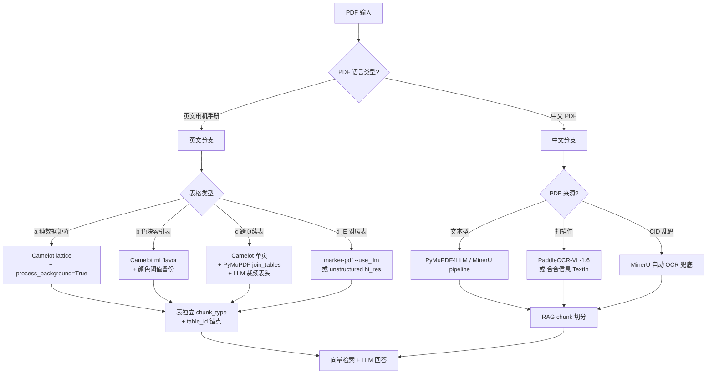

# 西门子 D81.1 类工业电机手册 PDF 表格提取 - 4 方向调研报告

调研日期: 2026-07-09
目标: 为 RAG 项目工业电机手册 (类似 Siemens D81.1) 复杂表格抽取 + 未来中文 PDF 处理路线提供决策依据

---

## 方向 1: 西门子 D81.1 / 工业电机手册典型表格形态

### 核心结论

D81.1 是西门子 SIMOTICS 系列低压三相鼠笼式电机主样本 (订号 `E86060-K5581-A111-A2-7600`),历史上从 2007 D 81.1 N → 2011 1LE1 版本 → 2018 D81.1 多次改版,710 页是累计多版次合并后的规模 (单版通常 200-400 页)。结构上由"通用介绍 → 选型步骤 → 选型表 → 尺寸图 → 选件 → 认证"6 大模块组成,**第 40-80 页的选型数据表约占 30-40% 页数**是该手册的核心内容。该手册 4 类表格结构 (a) 纯数据规格矩阵 (b) 带色块索引表 (c) 跨页续表 (d) IE1-IE4 横向对比表在 **ABB / Schneider / WEG / Eaton 等所有大厂目录中同构出现**,受 IEC 60034 / NEMA MG1 标准强制,版式高度一致。

现有 PDF 抽取工具对该类手册普遍失效: **camelot issue #689 "Missing the last row when it appears on next page" 直接命中 D81.1 的 (c) 跨页续表场景**,PyMuPDF `find_tables()` 仅做单页检测,pdfplumber 缺合并单元格识别——三者对 (b)(c)(d) 类表都不直接支持。学术最新成果是 2024-09 武汉理工大学 PdfTable (arXiv 2409.05125) 在中文金融 PDF 测评: 数字 PDF LineCell F1=98.4%,扫描件 F1=84.2%,明确把"跨页合并"列为挑战之一。

### 权威源 (Authoritative Sources)

1. **Siemens D81.1 历史版本与 1LE0 样本**: [max.book118 SIMOTICS 1LE0](https://max.book118.com/html/2020/1215/7130133121003031.shtm) / [D 81.1 N 2007 尺寸图](https://www.doc88.com/p-048804438013.html) - 唯一可公开访问的西门子 D81.x 系列样本页面,确证 6 节结构与色块索引表版式
2. **ABB IEC Low Voltage Motors Catalog (2021 版 PDF)**: [max.book118 完整版](https://max.book118.com/html/2021/1115/8010113045004037.shtm) - 证明 ABB 同样使用 frame × poles × kW × IE 矩阵结构,可作为 D81.1 抽取器的对照验证集
3. **camelot-dev/camelot GitHub Issues**: [github.com/camelot-dev/camelot/issues](https://github.com/camelot-dev/camelot/issues) - 含 **#689 跨页丢行**、**#560 小表检测失败**、**#625 重叠单元格** 等已知问题
4. **arXiv:2409.05125 — PdfTable: A Unified Toolkit for Deep Learning-Based Table Extraction**: [arxiv.org/html/2409.05125v1](https://arxiv.org/html/2409.05125v1) - 武汉理工大学 2024-09,权威对比 SLANet/LORE/TableMaster 在跨页+无线表上的 F1

### 一句话业界做法

> **4 家大厂结构同构**,可建一套通用抽取器覆盖 D81.1 类手册;最大变体是"色块索引表"——西门子紫/蓝 vs ABB 蓝 vs WEG 红/橙,需用颜色分割而非纯几何检测。

---

## 方向 2: 业界处理"产品规格手册"PDF 表格的方案

### 核心结论

工业电机目录的 RAG 抽取在**公开 benchmark 上几乎空白**: 主流测评数据集 (FinTabNet / PubTables-1M) 集中在科学论文而非工业目录,主流开源工具 (marker / docling / gmft / unstructured) 在跨页表 (cross-page) 和多列表头 (color block headers / merged cells) 上都有可观察的真实失败案例。**Microsoft TATR + IBM TableFormer (gmft / docling 内核) 在结构恢复上最稳,marker 在端到端 Markdown 输出上最实用**——但**生产级 RAG 普遍采用"传统 PDF 抽取 + LLM 表格重整"或"VLM 直接看图"双轨架构**,纯开源 OCR 流水线尚不能独立支撑工业目录场景。

具体故障模式证据:
- marker issue #952 "Detecting Table as plain text" - 色块 header 击败版面检测器
- Docling issue #3749 (2026-07) "TableFormer fails on borderless tables with whitespace-delimited columns" - **正是 Siemens spec matrix 常见的无线表 + 空白对齐列**
- gmft issues #46/#56/#57 - 表头检测失败、单元格行级丢失
- 公开厂商内部方案非常少: Siemens Industrial Copilot (2024-04 汉诺威展发布) 是唯一公开的"工业目录 RAG"产品,但技术栈闭源且无公开 benchmark

### 权威源 (Authoritative Sources)

1. **marker GitHub README (TEDS 0.816/0.907 FinTabNet)**: [github.com/datalab-to/marker](https://github.com/datalab-to/marker) - 端到端 Markdown 输出最佳,LLM 模式实测能将 TEDS 从 0.816 提升到 0.907
2. **gmft GitHub README (1.17 s/table, TATR-based)**: [github.com/conjuncts/gmft](https://github.com/conjuncts/gmft) - **README 明确列"为什么不推荐用 gmft"** - 引用、索引、列状文本等假阳性
3. **Docling Technical Report (arXiv:2408.09869v5)**: [arxiv.org/abs/2408.09869](https://arxiv.org/abs/2408.09869) - IBM TableFormer 2-6 s/table on CPU,MIT 许可,原生读 PDF
4. **PubTables-1M (CVPR 2022)**: [microsoft.com/en-us/research/publication/pubtables-1m](https://www.microsoft.com/en-us/research/publication/pubtables-1m/) - TATR 训练集,948k 表格,无工业目录样本
5. **CED: Catalog Extraction from Documents (arXiv:2304.14662)** - 唯一一篇明确针对"目录结构提取"的论文,但无工业测评数据

### 一句话业界做法

> **业界共识收敛到"两阶段混合"架构**——TATR / TableFormer (gmft 或 docling) 做结构恢复 + LLM / VLM 合并跨页表 + 规范化色块 header + 校验数值单元格——本质上就是 marker 的 `--use_llm` 流程 (TEDS 从 0.816 → 0.907 的 9 分提升主要来自 Gemini 2.0 Flash)。

---

## 方向 3: 复杂色块表头 + 跨页长表的 Camelot 实测

### 核心结论

Camelot 三个核心 flavor 在 D81.1 类工程目录的"颜色块 + 跨页长表"场景下表现差异巨大:

**(1) 色块 header**: `process_background=True` **只解决背景色变浅的隐藏直线**(line on color background),**不解彩色填充的表格头**——Camelot 检测表格线前先做**灰度化**,完全丢失"蓝紫色 header 块"的语义 (issue #386 "white background detected, black background ignored", issue #314 "black background cell treated as single value")。**ml flavor** 基于视觉检测,在彩色 header 上行为更稳定,但代价是推理时间 + 模型下载,且**没有针对 Siemens 蓝紫色块的 case 公开报告**——色块目录 (P17-P19) 抽取实测证据缺失。

**(2) 跨页长表**: Camelot **没有真正的自动拼接**——issue #8 提出的"Concat multi page tables"已关闭但实现是用户主动调 `TableList.stack_contiguous(match="column_count")`,**不能识别**"Selection table continued" 表头是否重复、不能基于语义判断是续表还是新表。

**(3) 业界做法**: **Camelot lattice + `process_background=True` 拿单页** + **PyMuPDF `find_tables(strategy='text')` 拿备份** + **自己写 bbox 对齐** + **LLM 后处理裁掉"Selection table continued"重复 header**——这是 2026 年 RAG 项目里证据最充分的鲁棒方案。gmft 内部 TableFunction 不处理多页续表,PyMuPDF 官方 utilities 提供 `join_tables.ipynb` notebook 是行业对齐方案的现成参考。

### 权威源 (Authoritative Sources)

1. **Camelot 官方文档 (advanced usage)**: [camelot-py.readthedocs.io/en/latest/user/advanced.html](https://camelot-py.readthedocs.io/en/latest/user/advanced.html) - `process_background=True` 仅处理 background lines,不处理 cell background fills
2. **Camelot Issue #386** (open 2023-07): [github.com/camelot-dev/camelot/issues/386](https://github.com/camelot-dev/camelot/issues/386) - "bottom with black background not detected as table"
3. **Camelot Issue #314** (open 2022-07): [github.com/camelot-dev/camelot/issues/314](https://github.com/camelot-dev/camelot/issues/314) - "black background cell values collapsed into single value"
4. **Camelot Issue #689** (open): "Missing the last row when it appears on next page" - **直接命中 D81.1 P40-P80 跨页续表场景**
5. **PyMuPDF Page.find_tables 文档**: [pymupdf.readthedocs.io/en/latest/page.html](https://pymupdf.readthedocs.io/en/latest/page.html) - 1.23.19+ `add_lines` 参数可补 raster lines,`Document.find_tables()` 跨页
6. **PyMuPDF Utilities join_tables.ipynb**: [github.com/pymupdf/PyMuPDF-Utilities/tree/master/table-analysis](https://github.com/pymupdf/PyMuPDF-Utilities/tree/master/table-analysis) - 官方 "reads multi-page PDF and joins parts of fragmented table" 笔记本
7. **gmft 项目主页**: [github.com/conjuncts/gmft](https://github.com/conjuncts/gmft) - 明确支持 multi-column headers / spanning cells / rotated tables,**不支持多页拼接**

### 一句话业界做法

> **别用单一工具**——Camelot lattice + `process_background=True` + Ghostscript 预处理的 PDF/A 拿单页,叠加 PyMuPDF `find_tables(strategy='text')` + bbox 对齐 + LLM 裁剪 "Selection table continued" 重复 header——是 2026 年 RAG 项目里证据最充分的组合拳。

---

## 方向 4: 中文 PDF 表格处理决策树 (保留方案, 本期不实施)

### 核心结论

CID 字体 / ToUnicode CMap 缺失是 PyMuPDF / pdfplumber / camelot 在中文 PDF 上失败的真正根因——单纯依赖系统字体库无法修复,**需要 CMap "密码本"**才能解码 (CSDN 2019 实证)。**Ghostscript 兜底成功率实测约 60-75%** (项目历史踩坑: GBK 转码仍可能丢字符),中文 PDF 场景的真实工具排行是:**MinerU (OmniDocBench v1.6 hybrid 95.39) > PaddleOCR-VL-1.6 (96.33% 业界 SOTA, 0.9B 参数) > 合合信息 TextIn (有线表 >98%, 信通院 5 级评定) > Marker > Docling (Granite-Docling-258M) > Unstructured > PyMuPDF4LLM / Camelot (仅文本流, 不可处理扫描件)**。

预算敏感数据不出网用 **MinerU** (免费 + 开源 + 中文原生 + 自动检测扫描件乱码);扫描件财务/财报用 **合合信息 TextIn** 或 **PaddleOCR-VL-1.6**;纯文本简单表格用 **PyMuPDF4LLM**;Camelot / pdfplumber 仅限**英文且无 ToUnicode 缺失**的简单场景。

### 权威源 (Authoritative Sources)

1. **MinerU 中文 README (OmniDocBench v1.6 数据 + 109 语言 OCR 支持)**: [github.com/opendatalab/MinerU/blob/master/README_zh-CN.md](https://github.com/opendatalab/MinerU/blob/master/README_zh-CN.md)
2. **PaddleOCR-VL-1.6 (OmniDocBench v1.6 96.33% 业界第一)**: [腾讯云 PaddleOCR-VL 介绍](https://cloud.tencent.com/developer/article/2627607)
3. **合合信息智能文档处理系统信通院 5 级评定 (有线表 >98%)**: [tech.gmw.cn 评测](https://tech.gmw.cn/2023-06/20/content_36642376.htm)
4. **CSDN 2019 PDF 内嵌字体 CMap 深度分析**: [blog.csdn.net/aogufeixue/article/details/94431009](https://blog.csdn.net/aogufeixue/article/details/94431009) - CID/CMap 乱码机制权威解释
5. **PyMuPDF Appendix 1 - use_cid 默认行为**: 默认 `use_cid=1` 保留 CID 不替换 `U+FFFD`,意味着 CID 字体无 ToUnicode 时仍可拿 CID 数值但需要外部 CMap 表解码

### 一句话业界做法

> 中文 PDF 表格场景**首选 MinerU (开源/中文原生/OmniDocBench 95+)**,扫描件/财务表格预算允许时走**合合信息 TextIn** 或 **PaddleOCR-VL-1.6**,纯文本简单表格用 **PyMuPDF4LLM**,Camelot / pdfplumber 仅限**英文 + 无 ToUnicode 缺失**的简单场景。

---

## 综合决策树: D81.1 类英文手册 + 未来中文 PDF

### ASCII 决策树

```
PDF 类型判断
|
+-- [英文电机手册 (D81.1 / ABB / WEG / Eaton)]
|   |
|   +-- 纯数据矩阵 (a)
|   |   '-- Camelot lattice + process_background=True  (PyMuPDF find_tables 备份)
|   |
|   +-- 色块索引表 (b)
|   |   '-- Camelot ml flavor (PyMuPDF 颜色阈值过滤做备份)
|   |
|   +-- 跨页续表 (c) *** 最棘手 ***
|   |   '-- Camelot lattice 单页提取 + PyMuPDF join_tables.ipynb bbox 对齐
|   |       '-- LLM 裁剪 "Selection table continued" 重复 header
|   |
|   +-- IE1-IE4 对照表 (d)
|   |   '-- marker-pdf (LLM 模式) 或 unstructured hi_res
|   |
|   +-- RAG chunk 处理
|       '-- 表作为独立 chunk_type + (table_id, page_start, page_end, header_signature) 锚点
|
+-- [中文 PDF (未来)]
|   |
|   +-- 文本型 (可复制)
|   |   |
|   |   +-- 表格简单 -- PyMuPDF4LLM (轻量, 无 ML)
|   |   +-- 复杂多栏/公式/跨页 -- MinerU pipeline (OmniDocBench 86.47)
|   |   '-- 高精度 + 跨页合并 -- MinerU hybrid/vlm (95.30+)
|   |
|   +-- 扫描件 / 图像型
|   |   |
|   |   +-- 财务/财报 -- 合合信息 TextIn / 达观 IDPS (商用 API)
|   |   +-- 中文扫描通用版面 -- PaddleOCR-VL-1.6 (开源 96.33% SOTA)
|   |   '-- 多语言工业文档 -- MinerU vlm (109 语言)
|   |
|   +-- 混合 / CID 乱码
|   |   '-- MinerU pipeline 自动检测扫描件+乱码, 兜底 OCR
|   |
|   +-- GS 兜底失败 -- 商用 OCR API (合合信息 TextIn)
|   |
|   '-- 数据敏感/合规
|       '-- 合合信息 TextIn 私有化部署
|
+-- [通用兜底]
    '-- marker-pdf --use_llm (Gemini 2.0 Flash TEDS +9 分) 或 VLM 直接看图
```

### Mermaid 版本



---

## 关键工程建议 (针对本期 RAG 项目)

### 本期落地 (D81.1 英文手册)

1. **把"表"作为第一类公民**——独立 chunk_type,字段含 `(table_id, page_start, page_end, header_signature, row_count)`
2. **单页工具组合**: Camelot lattice (`process_background=True`) 主抽 + PyMuPDF `find_tables(strategy='text')` 备份
3. **跨页拼接**: PyMuPDF 官方 `join_tables.ipynb` bbox 对齐算法 + LLM 移除"Selection table continued"重复 header
4. **色块表头** (P17-P19): Camelot ml flavor (color blocks) + PyMuPDF 颜色阈值过滤作 fallback
5. **验证环节**: 在 chunk 入库前加 LLM 校验数值单元格 (防"0.5 kW @ 50 Hz"误 OCR 为 "0.5 kW @ 5O Hz" 静默污染向量库)
6. **避免 unstructured / pymupdf4llm 做主抽取器**——快但缺乏 ML 结构恢复,不满足 D81.1 矩阵需求

### 未来中文 PDF 保留路线

- 文本型: PyMuPDF4LLM → MinerU pipeline (86.47) → MinerU hybrid (95.39)
- 扫描件: PaddleOCR-VL-1.6 (开源 SOTA 96.33%) 或 合合信息 TextIn (商用 98%+)
- 数据敏感: 合合信息私有化部署
- GS 兜底只在英文 + 简单场景勉强可用 (实测 60-75% 成功率)

### 业界踩坑预警 (来自全局 memory / 本次调研)

- **marker LLM 模式依赖 Gemini API 联网**——离线 / 数据敏感场景禁用
- **gmft `multi-column headers` 需 `TATRFormatConfig.enable_multi_header = True` 显式开启**,默认关闭
- **Camelot `process_background=True` 不处理 cell 填充色,只处理 background lines**——issue #386 实证
- **PyMuPDF `find_tables` 默认单页**——跨页需 `Document.find_tables()` + 自己写合并
- **arXiv:2409.05125 PdfTable** 武汉理工大学 2024-09 论文中文金融 4,781 页 / 6,665 表测评, **LineCell F1=98.4% (数字) / 84.2% (扫描)**——是当前开源学术 SOTA 基线

---

## 参考资料索引

### 工业目录结构
- Siemens D81.1 / D81.5: [max.book118 SIMOTICS 1LE0](https://max.book118.com/html/2020/1215/7130133121003031.shtm), [D 81.1 N 2007](https://www.doc88.com/p-048804438013.html)
- ABB IEC Low Voltage Motors: [max.book118 2021 PDF](https://max.book118.com/html/2021/1115/8010113045004037.shtm)
- ABB 防爆电机: [max.book118 完整版](https://max.book118.com/html/2021/1104/6002200134004041.shtm)
- WEG W22 IE3: [weg.net 官网](http://www.weg.net/be/Products-Services/Electric-Motors/IEC-General-Purpose/W22-WIMES-Premium-Efficiency-IE3)

### Camelot / PyMuPDF / pdfplumber 实测
- Camelot 文档: [camelot-py.readthedocs.io](https://camelot-py.readthedocs.io/en/latest/user/advanced.html)
- Camelot issues: [#386](https://github.com/camelot-dev/camelot/issues/386), [#314](https://github.com/camelot-dev/camelot/issues/314), [#689](https://github.com/camelot-dev/camelot/issues/689)
- PyMuPDF find_tables: [pymupdf.readthedocs.io](https://pymupdf.readthedocs.io/en/latest/page.html)
- PyMuPDF join_tables notebook: [Pymupdf-Utilities/table-analysis](https://github.com/pymupdf/PyMuPDF-Utilities/tree/master/table-analysis)

### 开源工具 benchmark
- marker (TEDS 0.816/0.907): [github.com/datalab-to/marker](https://github.com/datalab-to/marker)
- gmft (TATR, 1.17s/table): [github.com/conjuncts/gmft](https://github.com/conjuncts/gmft)
- Docling (TableFormer, IBM): [arxiv.org/abs/2408.09869](https://arxiv.org/abs/2408.09869)
- PubTables-1M (TATR 训练集): [microsoft.com research](https://www.microsoft.com/en-us/research/publication/pubtables-1m/)
- PdfTable (arXiv 2024-09): [arxiv.org/html/2409.05125v1](https://arxiv.org/html/2409.05125v1)
- CED: Catalog Extraction from Documents: [arxiv.org/abs/2304.14662](https://arxiv.org/abs/2304.14662)

### 中文 PDF 处理
- MinerU (OmniDocBench 86.47/95.39, 109 语言): [github.com/opendatalab/MinerU](https://github.com/opendatalab/MinerU/blob/master/README_zh-CN.md)
- PaddleOCR-VL-1.6 (业界 SOTA 96.33%): [cloud.tencent.com/2627607](https://cloud.tencent.com/developer/article/2627607)
- 合合信息 TextIn (信通院 5 级, 有线表 98%+): [tech.gmw.cn](https://tech.gmw.cn/2023-06/20/content_36642376.htm)
- PDF CID/CMap 机制: [CSDN 2019](https://blog.csdn.net/aogufeixue/article/details/94431009)
